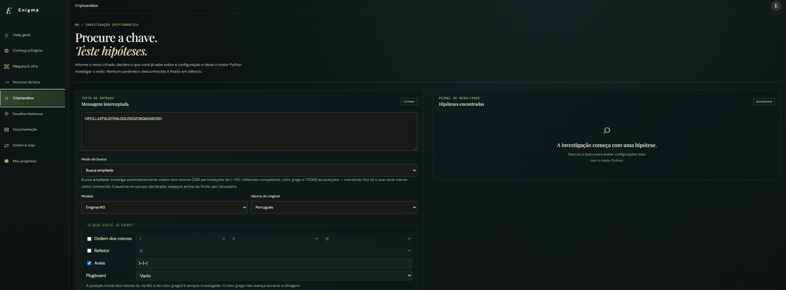

# Enigma M3/M4 — Simulador e Laboratório de Criptoanálise

Simulador educativo da máquina Enigma M3 e M4, desenvolvido em Python, com API Flask, interface web em HTML/CSS/JavaScript e ferramentas de criptoanálise.

O projeto reúne três objetivos: reproduzir o funcionamento eletromecânico da Enigma, permitir cifrar/decifrar mensagens e explorar como a criptoanálise recupera configurações desconhecidas.

> **Estado do projeto:** em desenvolvimento. Os resultados de desempenho descritos neste README são medições realizadas no computador de desenvolvimento e podem variar conforme o hardware e o tamanho da mensagem.


**Configuração da máquina**


**Criptoanálise**



## Visão geral

A Enigma foi uma família de máquinas eletromecânicas de cifragem utilizadas, entre outros contextos, pelas forças armadas alemãs durante a Segunda Guerra Mundial. A segurança das comunicações dependia de configurações envolvendo rotores, anéis, posições iniciais, refletor e, nas variantes correspondentes, plugboard.

Este projeto implementa o caminho elétrico da máquina em Python. Na cifragem, o sinal passa pelo plugboard, pelos rotores, pelo refletor e retorna pelos componentes em sentido inverso. O motor também implementa o avanço dos rotores e o duplo avanço (*double-stepping*).

Na variante naval M4, o rotor grego Beta ou Gamma participa do caminho elétrico, mas **não avança durante a cifragem normal**. Os três rotores principais continuam seguindo o mecanismo de avanço da máquina.

## Funcionalidades

### Máquina Enigma

- Modelos M3 e M4.
- Rotores principais I–VIII.
- Rotores gregos Beta e Gamma para M4.
- Refletores B e C para M3; Bfino e Cfino para M4.
- Configuração de posições iniciais e anéis.
- Plugboard com validação de conexões.
- Avanço dos rotores e duplo avanço.
- Cifragem e decifragem recíprocas.
- Rastreamento do percurso elétrico de uma letra, etapa por etapa.

### API e interface

- API HTTP desenvolvida com Flask.
- Interface em HTML, CSS e JavaScript puro, sem framework de frontend.
- Comunicação entre frontend e backend por JSON.
- Tarefas de criptoanálise em segundo plano.
- Progresso real e cancelamento das tarefas.
- Servimento da interface e dos arquivos locais pelo Flask.
- Sessão Flask para registrar progresso e conquistas por navegador.

### Criptoanálise

A criptoanálise possui três modos:

1. **Configurada:** busca as posições iniciais quando rotores, anéis, refletor e demais parâmetros necessários são conhecidos.
2. **Ampliada:** enumera exaustivamente as dimensões declaradas desconhecidas, respeitando o orçamento configurado para a busca.
3. **Avançada:** combina triagem de candidatos e refinamento heurístico para dimensões como anéis e plugboard desconhecidos.

A busca usa pontuação linguística por quadrigramas em português e inglês. Em determinados cenários, avalia os dois idiomas para reduzir o impacto de nomes próprios, marcas e estrangeirismos.

A busca ampliada pode investigar permutações dos rotores principais, refletores compatíveis, rotor grego e posições iniciais. A busca de anéis é limitada pelas equivalências elétricas documentadas no módulo de criptoanálise.

**Importante sobre o alcance:** a busca avançada não enumera todas as configurações possíveis de plugboard. Ela utiliza heurísticas e, portanto, não garante encontrar a chave correta em todos os textos. Os resultados finais são decifrados e verificados pelo motor Enigma real. A cobertura informada refere-se ao escopo efetivamente configurado para cada execução, não a todo o espaço teórico de chaves da Enigma.

### Desafios históricos

- Quatro missões educativas com contexto histórico e indicação de reconstrução educacional.
- Modos guiado, investigação e especialista.
- Dicas progressivas.
- Validação das respostas pelo motor real.
- Pontuação por modo.
- Conquistas vinculadas às missões.
- Galeria histórica liberada após a conclusão.
- Progresso registrado em sessão assinada do Flask.

O progresso atual é associado ao navegador por cookie de sessão. **Ainda não é um sistema de contas de usuário nem sincroniza automaticamente entre dispositivos ou navegadores.**

### Fotografias da galeria

As imagens locais devem ficar em:

```text
enigma_frontend/
└── assets/
    └── galeria/
```

Nomes previstos para as fotografias da galeria:

```text
m1-enigma-em-uso.jpg
m1-enigma-museu.jpg
m2-afrika-korps-comboio.jpg
m2-soldado-deserto.jpg
m3-escolta-atlantico.jpg
m3-comboio-tropas.jpg
m4-bombe-1945.jpg
m4-bletchley-park-atual.jpg
```

Cada imagem deve manter identificação, legenda, instituição de origem e crédito/licença conforme a fonte original. Fotografias atuais de museus ou edifícios preservados devem ser identificadas como atuais, não como registros produzidos durante a guerra.

## Tecnologias e dependências

- **Python 3.10+** — motor, API, tarefas e criptoanálise.
- **Flask** — servidor HTTP.
- **Flask-CORS** — configuração de CORS.
- **NumPy** — operações vetorizadas usadas pela busca ampliada e avançada.
- **pytest** — testes automatizados.
- **HTML, CSS e JavaScript puro** — interface.

As dependências Python estão listadas em `requirements.txt`.

## Arquitetura

- **Frontend (`enigma_frontend/`)**: apresenta telas, configurações e resultados; chama a API. Não implementa o motor criptográfico.
- **API (`api.py`)**: valida requisições, cria máquinas, expõe rotas e coordena as tarefas.
- **Motor (`enigma.py`)**: implementação central da máquina. É reutilizado pela API, pela CLI, pelos testes e pela verificação final de candidatos.
- **Criptoanálise (`criptoanalise.py`)**: busca de posições para uma configuração recebida.
- **Busca ampliada (`busca_configuracoes.py`)**: enumeração de dimensões desconhecidas e refinamento heurístico.
- **Tarefas (`tarefas.py`)**: execução em segundo plano, estado, progresso e cancelamento.
- **Pontuação (`pontuacao.py`)**: normalização e avaliação linguística.
- **Desafios (`desafios.py`)**: catálogo de missões, dicas, conquistas e dados da galeria.

## Como instalar e executar

### 1. Clonar o repositório

```bash
git clone https://github.com/emanoelpr/maquina-enigma-flask.git
cd maquina-enigma-flask
```

### 2. Criar e ativar o ambiente virtual

Windows PowerShell:

```powershell
python -m venv .venv
.\.venv\Scripts\Activate.ps1
```

Windows Prompt de Comando:

```bat
python -m venv .venv
.venv\Scripts\activate
```

Linux/macOS:

```bash
python3 -m venv .venv
source .venv/bin/activate
```

### 3. Instalar as dependências

```bash
python -m pip install --upgrade pip
python -m pip install -r requirements.txt
```

### 4. Iniciar a aplicação

Na pasta raiz do projeto:

```bash
python api.py
```

Abra no navegador:

```text
http://127.0.0.1:5000/
```

A API também possui uma rota de verificação:

```text
http://127.0.0.1:5000/api/health
```

**Use o endereço servido pelo Flask.** A aplicação utiliza a mesma origem para frontend, API, cookies de sessão e imagens locais. Não abra `index.html` diretamente com `file://` para testar o fluxo completo.

## Como testar

Executar a suíte de testes:

```bash
python -m pytest
```

Execução mais silenciosa:

```bash
python -m pytest -q
```

Os testes reais ficam na pasta `testes/`. Essa pasta **deve ser versionada no Git**. O que não deve ser enviado são os caches e artefatos gerados pelo pytest e pelo Python, como `.pytest_cache/`, `__pycache__/` e arquivos `.pyc`; esses itens estão cobertos pelo `.gitignore`.

### Testes pesados de criptoanálise M4

Alguns testes de cobertura ampla levam vários minutos e ficam desativados por padrão para não tornar a suíte cotidiana lenta.

Exemplo — busca M4 do Comboio com todas as ordens de rotores principais:

```powershell
$env:ENIGMA_TESTE_M4_TODOS_ROTORES="1"
python -m pytest testes/test_m4_comboio_todos_rotores.py::test_m4_comboio_busca_todas_as_ordens -q -s
Remove-Item Env:ENIGMA_TESTE_M4_TODOS_ROTORES
```

Bateria M4, cenário Gamma/Cfino:

```powershell
$env:ENIGMA_TESTE_M4_BATERIA="1"
$env:ENIGMA_TESTE_M4_CASO="gamma-cfino"
python -m pytest "testes/test_bateria_confiabilidade_m4.py::test_busca_m4_exaustiva_e_registra_confiabilidade" -q -s
Remove-Item Env:ENIGMA_TESTE_M4_BATERIA
Remove-Item Env:ENIGMA_TESTE_M4_CASO
```

Outros testes isolados usam variáveis de ambiente próprias, descritas nos respectivos arquivos ou guias. Execute-os separadamente e confira o escopo, o total de configurações e o tempo reportado.

### Resultados de desempenho já observados

Medições relatadas durante o desenvolvimento, no computador de desenvolvimento:

| Cenário | Configurações avaliadas | Tempo observado |
|---|---:|---:|
| M3 configurada (posições iniciais) | 17.576 | 0,42 s |
| M4 configurada (posições iniciais) | 456.976 | 8,54 s |
| M3 ampliada (ordem e refletor desconhecidos) | 11.811.072 | 65,16 s |
| M4 controlada (grego, refletor e posições desconhecidos; ordem conhecida) | 1.827.904 | 3,73–8,75 s, conforme o teste |
| M4 Comboio (ordem dos rotores principais desconhecida) | 614.175.744 | 919,37 s |
| M4 Gamma/Cfino (bateria de confiabilidade) | 614.175.744 | 1.072,28 s |

Esses números são referências experimentais, não garantias de desempenho em outros computadores. Nos dois últimos cenários, a mensagem correta foi recuperada entre os candidatos avaliados, com a configuração ou equivalência elétrica confirmada pelo teste.

O número de testes aprovados deve ser obtido executando a suíte no ambiente atual; não é fixado neste README porque novos testes isolados podem ser adicionados e alguns são ignorados por padrão.

## Rotas principais da API

| Método | Rota | Descrição |
|---|---|---|
| GET | `/api/health` | Verifica se a API está ativa |
| POST | `/api/cifrar` | Cifra ou decifra uma mensagem |
| POST | `/api/percurso` | Calcula o percurso elétrico de uma letra |
| POST | `/api/criptoanalise` | Busca síncrona legada de posições |
| POST | `/api/criptoanalise/escopo` | Descreve o espaço de busca solicitado |
| POST | `/api/criptoanalise/tarefas` | Inicia uma busca em segundo plano |
| GET | `/api/criptoanalise/tarefas/<id>` | Consulta o estado e o progresso |
| POST | `/api/criptoanalise/tarefas/<id>/cancelar` | Solicita o cancelamento |
| GET | `/api/desafios` | Lista as missões |
| GET | `/api/desafios/<id>` | Consulta o detalhe de uma missão |
| POST | `/api/desafios/<id>/dica` | Solicita dicas progressivas |
| POST | `/api/desafios/<id>/verificar` | Valida a resposta e registra a conclusão |
| GET | `/api/desafios/progresso` | Consulta o progresso da sessão |
| GET | `/api/desafios/conquistas` | Lista o catálogo de conquistas |
| GET | `/api/desafios/<id>/configuracao-guiada` | Obtém a configuração do modo guiado |
| GET | `/api/desafios/<id>/galeria` | Obtém a galeria após a conclusão |

## Exemplo: cifrar uma mensagem pela API

```bash
curl -X POST http://127.0.0.1:5000/api/cifrar \
  -H "Content-Type: application/json" \
  -d '{
    "modelo": "M3",
    "mensagem": "HELLO WORLD",
    "rotores": ["I", "II", "III"],
    "posicoes": ["A", "A", "A"],
    "aneis": [1, 1, 1],
    "refletor": "B",
    "plugboard": "AV BS CG"
  }'
```

A mesma configuração pode ser usada para decifrar o resultado, pois a Enigma é recíproca: cifrar novamente o texto cifrado com a mesma configuração recupera o texto original.

## Contexto histórico

A criptoanálise da Enigma envolveu equipes e contribuições de diferentes países. Marian Rejewski e outros matemáticos poloneses realizaram avanços fundamentais antes da guerra. Posteriormente, o trabalho britânico em Bletchley Park reuniu matemáticos, linguistas, operadores e equipes técnicas. A Bombe ajudava a testar hipóteses sobre configurações; não era, por si só, uma máquina que simplesmente traduzia qualquer mensagem.

As missões deste projeto são **reconstruções educacionais**, salvo indicação explícita em contrário. Mensagens criadas para o jogo não devem ser apresentadas como interceptações históricas autênticas.

## Autor

**Emanoel do Prado** — Estudante de Sistemas de Informação

- LinkedIn: [www.linkedin.com/in/emanoel-do-prado-634b7913b](https://www.linkedin.com/in/emanoel-do-prado-634b7913b)
- GitHub: [github.com/emanoelpr](https://github.com/emanoelpr)

## Licença

Este projeto está sob a licença MIT. Consulte o arquivo `LICENSE` do repositório. A licença do código do projeto não substitui as licenças e os créditos específicos das fotografias, corpora e demais materiais de terceiros.
