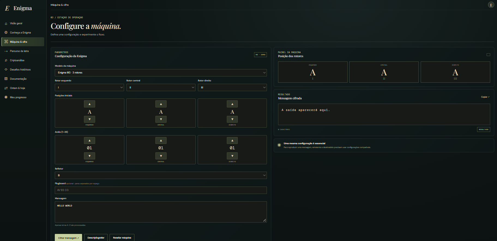

# Enigma M3/M4 — Simulador e Laboratório de Criptoanálise

Simulador da máquina Enigma (M3 e M4) escrito em Python, com motor de cifragem fiel, API em Flask, interface web em JavaScript puro e um módulo de criptoanálise por força bruta sobre posições iniciais.

## Sobre

A Enigma foi a família de máquinas de cifragem eletromecânicas usada pelas forças alemãs entre as décadas de 1920 e 1940. O sigilo dependia de rotores intercambiáveis, de um refletor e de uma configuração diária trocada por listas de chaves.

Este projeto reimplementa o funcionamento elétrico do equipamento em Python: o sinal atravessa plugboard, três rotores, refletor e retorna pelo mesmo caminho invertido — com duplo avanço, rotor grego e refletores finos da variante naval M4.

Sobre esse motor há uma API Flask, uma interface web e um módulo de criptoanálise que tenta recuperar a chave por busca exaustiva de posições iniciais.

## Features

**Implementado**

- Motor Enigma M3 e M4 com rotores I–VIII, Beta e Gamma.
- Duplo avanço dos rotores, com entalhes simples e duplos (VI, VII, VIII).
- Refletores B e C (M3) e B-Thin / C-Thin (M4), com validação de simetria.
- Rotor grego na quarta posição da M4: participa do caminho elétrico, não gira.
- Plugboard com até 13 conexões e validação de pares.
- Configuração de anel de 1 a 26 por rotor.
- Rastreamento do percurso elétrico de uma letra, etapa por etapa, com as posições dos rotores no momento da transformação.
- API Flask para cifrar, decifrar e calcular o percurso.
- Criptoanálise por força bruta sobre posições iniciais (26³ na M3, 26⁴ na M4).
- Pontuação linguística por quadrigramas em português e inglês, com desempate por viés de idioma e bônus de palavras frequentes.
- Busca em duas etapas para textos longos: triagem por prefixo, reavaliação dos melhores candidatos com o texto completo.
- Execução em segundo plano com progresso real e cancelamento.
- CLI com cifragem, decifragem e exibição da configuração.
- Quatro missões históricas com dicas progressivas, pontuação por modo de jogo e galeria liberada após a conclusão.
- 234 testes com pytest cobrindo motor, rotores, refletor, plugboard, CLI, API, criptoanálise e missões.

**Em desenvolvimento**

- Conclusão de missão pela interface: a rota de verificação responde 500 por inconsistência de importação no `api.py`.
- Galeria histórica: os caminhos das imagens em `desafios.py` não coincidem com a pasta real do projeto.
- Formulário de criptoanálise ainda não expõe rotores, anéis, refletor e plugboard.
- Telas "Documentação" e "Ontem & hoje" têm conteúdo estático no HTML.

## Stack

- **Python 3.10+** — motor, CLI, API e criptoanálise
- **Flask** — servidor HTTP da API
- **Flask-CORS** — liberação de origem para a interface local
- **pytest** — suíte de testes
- **HTML, CSS e JavaScript puro** — interface, sem framework nem build

## Arquitetura

**Frontend** — apenas apresentação e orquestração de chamadas. Não implementa cifra.
**API** — traduz JSON em configuração validada, trata erros como HTTP 400/500 e serializa a saída.
**Motor** — cifra pura, sem dependência de Flask. É a mesma classe usada pela CLI, pela API e pela criptoanálise.
**Criptoanálise** — camada separada que reutiliza o motor para gerar candidatos e usa `pontuacao.py` para ranqueá-los.

## Como rodar

1. Clone o repositório e entre na pasta:

git clone https://github.com/seu-usuario/enigma-machine.git
cd enigma-machine

2. Crie e ative o ambiente virtual:
# Windows (PowerShell)
python -m venv .venv
.venv\Scripts\Activate.ps1

# Linux / macOS
python3 -m venv .venv
source .venv/bin/activate

3. Instale as dependências:
pip install -r requirements.txt

4. Rode a API:
python api.py

- O servidor fica em http://127.0.0.1:5000. Confira com curl http://127.0.0.1:5000/api/health.

5. Abra a interface. Duas opções:
# direto no navegador
open enigma_frontend/index.html        # macOS
start enigma_frontend\index.html       # Windows
xdg-open enigma_frontend/index.html    # Linux

# ou por um servidor local, se preferir
python -m http.server 8000 --directory enigma_frontend
# acesse http://localhost:8000

- O app.js aponta para http://127.0.0.1:5000, então a API precisa estar rodando.

## Requirements:
Flask>=3.0
flask-cors>=4.0
pytest>=8.0

## Como testar:
python -m pytest testes -q

- A suíte tem 234 testes coletados (197 funções, ampliadas por parametrização), em 19 arquivos
- Estado atual: 229 passam e 5 falham — as falhas estão concentradas em test_desafios.py e
- test_fase21.py, ligadas à conclusão de missões e ao caminho das imagens da galeria.

## Estrutura do Projeto

enigma_machine/
├── enigma.py                  # máquina M3/M4: avanço, cifra, rastreamento
├── rotor.py                   # fiação, entalhes, anel e posição
├── refletor.py                # refletores B, C, Bfino, Cfino
├── plugboard.py               # pares de letras, até 13 conexões
├── configuracao.py            # dicionário de configuração
├── api.py                     # rotas Flask
├── tarefas.py                 # busca em thread, progresso e cancelamento
├── criptoanalise.py           # força bruta sobre posições iniciais
├── pontuacao.py               # trigramas e quadrigramas (pt/en)
├── desafios.py                # catálogo de missões, dicas e conquistas
├── cli.py                     # interface de linha de comando
├── modelo_ngramas.json        # modelo de quadrigramas pré-calculado
├── corpora/                   # textos do Project Gutenberg usados no modelo
├── scripts/
│   ├── gerar_ngramas.py       # extrai trigramas dos corpora
│   ├── gerar_modelo.py        # monta o modelo de quadrigramas
│   └── benchmark_criptoanalise.py
├── enigma_frontend/
│   ├── index.html             # nove telas
│   ├── css/style.css
│   └── js/app.js              # navegação e chamadas à API
├── galeria/                   # fotografias históricas
└── testes/                    # 19 arquivos de teste

## Exemplos de uso da API

- Health check:
curl http://127.0.0.1:5000/api/health
{"status": "ok", "mensagem": "API Enigma funcionando."}

## Cifrar uma mensagem (M3)
curl -X POST http://127.0.0.1:5000/api/cifrar \
  -H "Content-Type: application/json" \
  -d '{
    "modelo": "M3",
    "mensagem": "HELLO WORLD",
    "rotores": ["I", "II", "III"],
    "posicoes": ["A", "A", "A"],
    "aneis": [1, 1, 1],
    "refletor": "B",
    "plugboard": "AV BS CG"
  }'

{
  "modelo": "M3",
  "mensagem_original": "HELLOWORLD",
  "resultado": "ILSDVVMTVZ",
  "quantidade_caracteres": 10
}

- A mesma configuração decifra: enviar ILSDVVMTVZ devolve HELLOWORLD. Isso vem do refletor, que torna a cifra recíproca.

## Percurso de uma letra
curl -X POST http://127.0.0.1:5000/api/percurso \
  -H "Content-Type: application/json" \
  -d '{"modelo":"M3","letra":"H","rotores":["I","II","III"],
       "posicoes":["A","A","A"],"aneis":[1,1,1],"refletor":"B","plugboard":""}'

{
  "letra_entrada": "H",
  "letra_saida": "I",
  "posicoes_finais": ["A", "A", "B"],
  "etapas": [
    {"componente": "Plugboard (entrada)", "antes": "H", "depois": "H"},
    {"componente": "Rotor III", "sentido": "ida", "antes": "H", "depois": "Q", "posicao": "B"},
    {"componente": "Refletor B", "antes": "X", "depois": "J"}
  ]
}

- A resposta traz o caminho completo; o trecho acima está resumido. posicoes_finais permite enviar a próxima letra continuando exatamente de onde a anterior parou.

## Demais rotas
Método	    Rota	                              Função
POST	      /api/cifrar	                        Cifra ou decifra um texto
POST	      /api/percurso	                      Percurso elétrico de uma letra
POST	      /api/criptoanalise	                Busca síncrona de posições
POST	      /api/criptoanalise/tarefas	        Inicia busca em segundo plano
GET	        /api/criptoanalise/tarefas/<id>	    Progresso real da busca
POST	      /api/criptoanalise/tarefas/<id>/cancelar	Cancela a busca
GET	        /api/desafios	                      Catálogo público de missões
GET       	/api/desafios/<id>	                Detalhe da missão
POST	      /api/desafios/<id>/dica	            Dicas progressivas
POST	      /api/desafios/<id>/verificar	      Valida a resposta (instável)
GET	        /api/desafios/progresso	            Progresso da sessão (instável)
GET	        /api/desafios/conquistas	          Catálogo de conquistas
GET	        /api/desafios/<id>/configuracao-guiada	Configuração oficial da missão
GET	        /api/desafios/<id>/galeria	        Galeria, só após concluir

## Criptoanálise

- O módulo criptoanalise.py recebe um texto cifrado e testa posições iniciais, mantendo fixos os rotores, os anéis e o refletor informados. Na M3 o espaço é de 26³ = 17.576 combinações; na M4, 26⁴ = 456.976.

- Para cada combinação, o texto é decifrado e pontuado por um modelo de quadrigramas calculado sobre corpus do Project Gutenberg (Machado de Assis, José de Alencar, Austen, Dickens, Melville). A pontuação avalia o texto nos dois idiomas e fica com o melhor resultado, com um viés pequeno a favor do idioma escolhido e um bônus para palavras frequentes. Textos com mais de 60 letras passam por duas etapas: triagem das 2.048 melhores combinações com um prefixo de 50 letras e reavaliação desses candidatos com o texto completo.

- Parâmetros principais: texto cifrado, três rotores principais, três anéis (1–26), refletor, idioma (pt ou en), modelo (M3 ou M4), rotor grego na M4 e limite de candidatos (1–100).

- Retorno: total de combinações testadas, idioma, tempo em segundos e a lista ordenada de candidatos, cada um com texto decifrado, posições, rotores, anéis, refletor e pontuação.

- Limitação conhecida: a busca assume plugboard vazio. Com conexões ativas, o espaço cresce para um tamanho que esta implementação não cobre.

## Status do projeto

✅ Motor Enigma M3 e M4 (rotores, refletor, plugboard, duplo avanço)
✅ Percurso elétrico de uma letra
✅ API de cifragem e decifragem
✅ Criptoanálise no backend, com progresso e cancelamento
✅ CLI
⚠️ Criptoanálise na interface: conectada à API, mas com rotores e anéis fixos
⚠️ Desafios históricos: catálogo, dicas e galeria prontos; a verificação de resposta retorna erro 500
⚠️ Galeria histórica: imagens presentes no repositório, caminho inconsistente no código
⚠️ Suíte de testes: 229 de 234 passando
❌ Telas "Documentação" e "Ontem & hoje" ligadas a conteúdo dinâmico
❌ Criptoanálise com plugboard

## Contexto Histórico

- A quebra da Enigma não foi obra de uma pessoa. O matemático polonês Marian Rejewski reconstruiu a fiação da máquina em 1932, trabalhando só com interceptações. Em 1939, com a invasão da Polônia, o método e os equipamentos foram entregues aos britânicos, que instalaram a operação em Bletchley Park.

- Ali, Alan Turing e Gordon Welchman desenvolveram a Bombe, máquina eletromecânica que testava hipóteses sobre a configuração do dia. A leitura do tráfego alemão contribuiu para a Batalha do Atlântico e para o esforço aliado, ainda que o alcance real dessa contribuição seja objeto de debate entre historiadores.

- O trabalho permaneceu secreto por décadas e só se tornou público nos anos 1970.

## Autor

- Emanoel do Prado, Estudante de Sistemas de Informação

- Linkedin: www.linkedin.com/in/emanoel-do-prado-634b7913b
- GitHub: https://github.com/emanoelpr